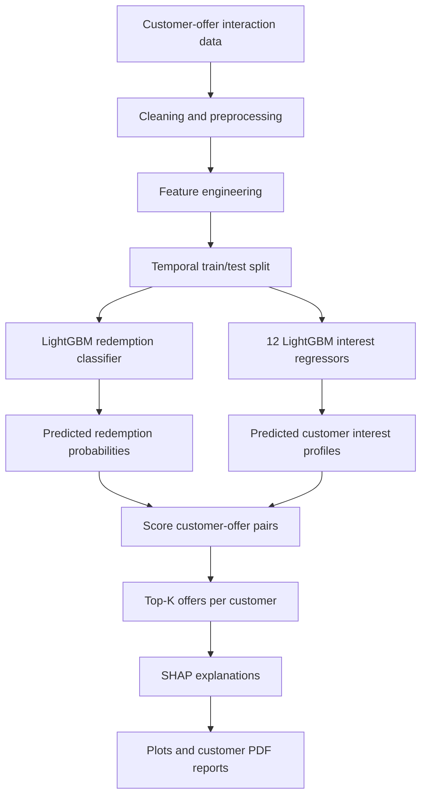
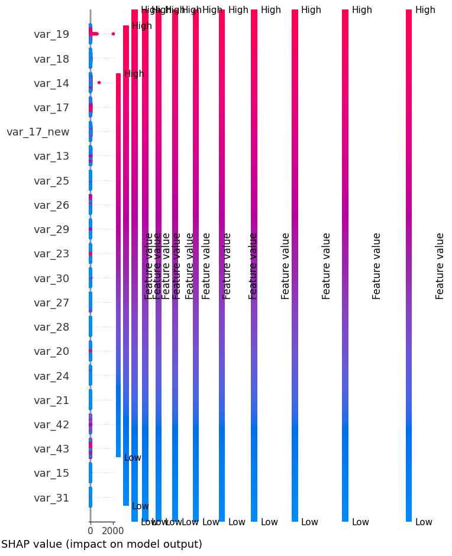
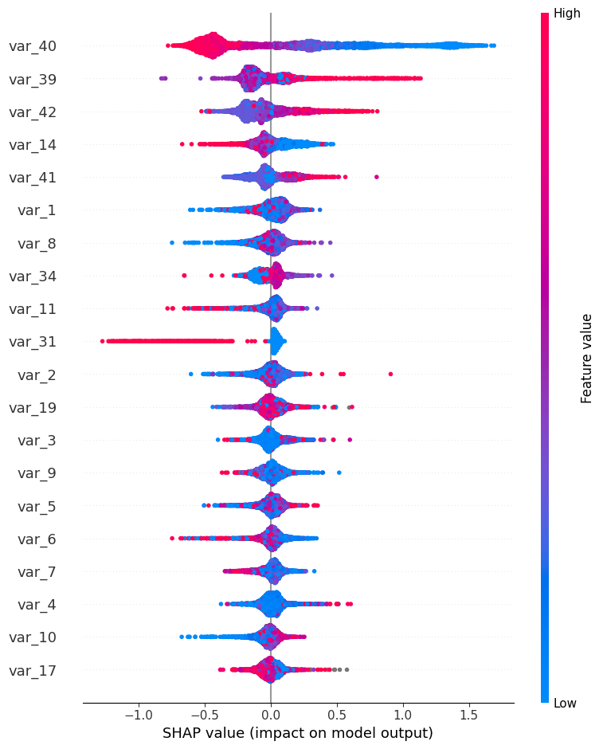
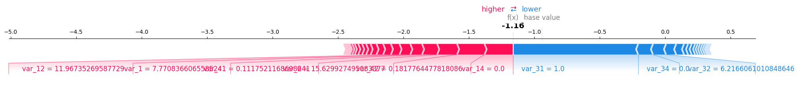
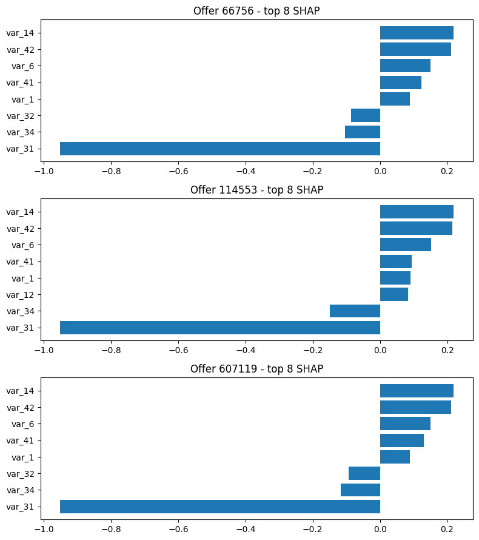

# Offer Personalization ML

<p align="center">
  <strong>Personalized offer ranking with LightGBM, customer-interest modeling, and SHAP explanations.</strong>
  <br />
  An end-to-end notebook pipeline that estimates offer redemption likelihood, predicts customer interest profiles, ranks top offers, and explains model outputs.
</p>

<p align="center">
  
  
  
  
</p>

---

## Overview

Offer Personalization ML explores how customer, engagement, transaction-pattern, and offer-category features can be used to rank offers for each customer.

The notebook combines three modeling tasks:

1. **Redemption prediction:** a LightGBM classifier estimates the probability of an offer action/redemption.
2. **Customer-interest prediction:** 12 LightGBM regressors predict the interest-score fields `var_1`–`var_12`.
3. **Personalized ranking:** candidates are scored and the top offers are returned for a customer.

SHAP is used to investigate feature contributions for the redemption model and interest predictions. The notebook also contains customer-level explanation helpers and PDF report generation.

> This is an experimental personalization pipeline. Model scores are estimates based on the provided dataset, not guarantees of redemption. The notebook accesses customer-offer data and should only be run with authorized, appropriately protected data.

## At a glance

| Component | Notebook implementation |
| --- | --- |
| Input data | Parquet customer-offer interaction dataset |
| Data preprocessing | Numeric coercion, missing-value filling, log scaling for selected monetary variables, CTR clipping |
| Redemption model | `LGBMClassifier` with class weighting |
| Interest models | 12 separate `LGBMRegressor` models for `var_1`–`var_12` |
| Ranking | `recommend_k(customer_row, offers_df, k=3)` |
| Explainability | SHAP TreeExplainer, summary / waterfall / offer-comparison outputs |
| Reporting | Customer PDF report with offer rankings and explanations |

## Architecture



Editable diagram source: [`docs/diagrams/architecture.mmd`](docs/diagrams/architecture.mmd).

## Modeling workflow

### 1. Data preparation

The notebook loads a Parquet dataset and works with `customer_id`, `offer_id`, event timestamps, `offer_action`, and feature columns `var_1`–`var_50`.

Feature families used in the notebook include:

| Feature group | Columns | Intended signal |
| --- | --- | --- |
| Customer interest scores | `var_1`–`var_12` | Category-level interest profiles |
| Engagement features | `var_13`–`var_16` | Interaction and engagement patterns |
| Spend/debit patterns | `var_17`–`var_30` | Monetary behavior |
| Offer metadata | `var_32`–`var_38` | Offer-related attributes |
| CTR / engagement | `var_39`–`var_43` | Click-through and related engagement signals |
| Offer categories | `var_44`–`var_50` | Encoded offer-category attributes |

Preprocessing includes converting `var_*` columns to numeric values, filling missing values with zero, applying `log1p` to selected high-variance fields, and clipping selected CTR variables to the range `[0, 1]`. Confirm the business meaning and preprocessing assumptions for each field before using this with another dataset.

### 2. Redemption prediction

The notebook trains a LightGBM classifier to estimate `P(offer_action = 1 | features)`. Its first evaluation reports ROC-AUC and PR-AUC on a temporal test set.

The first reported classifier run in the notebook shows:

| Metric | Reported value |
| --- | ---: |
| ROC-AUC | 0.763 |
| PR-AUC | 0.222 |

A later classifier run, using a separate feature setup in the notebook, reports:

| Metric | Reported value |
| --- | ---: |
| ROC-AUC | 0.8903 |
| PR-AUC | 0.5549 |

These results come from different stages/configurations in the notebook and should not be treated as a direct apples-to-apples comparison without reconciling the feature construction, target setup, and split. PR-AUC also depends strongly on positive-class prevalence.

### 3. Customer-interest prediction

Twelve individual LightGBM regressors are trained for `var_1` through `var_12`. The notebook evaluates each with RMSE, MAE, and \(R^2\), then uses the predicted interests as part of the recommendation workflow.

Example reported metrics for the first interest target:

| Target | RMSE | MAE | \(R^2\) |
| --- | ---: | ---: | ---: |
| `var_1` | 119.5395 | 7.7137 | 0.7390 |
| `var_2` | 113.3345 | 7.9522 | 0.7540 |

The output is target-specific; metric scales depend on the target scale. Consult the notebook outputs for the full set of 12 regression results.

### 4. Top-K personalized ranking

The `recommend_k()` helper constructs customer-offer candidate rows, predicts the interest fields, scores candidates with the redemption classifier, sorts by score, and returns the top `k` offers.

The default example returns the top three offers for a selected customer. Ranking scores should be interpreted as model scores; their calibration and business effectiveness require additional evaluation.

### 5. Explainability with SHAP

The notebook includes explanations at several levels:

- Summary analysis for the 12 interest models.
- SHAP feature contributions for the redemption classifier.
- Waterfall explanations for an individual prediction.
- Comparisons of candidate offers for a customer.
- A unified explanation helper combining customer and offer signals.
- PDF report generation.

### SHAP visualizations

**Interest-model summary**



**Redemption classifier explanation**



**Individual offer prediction**



**Comparing candidate offers**



## Repository contents

```text
Offer-Personalization/
├── offer_personalisation.ipynb       # Main end-to-end notebook
├── README.md
├── compare_offers.png                # SHAP comparison image already in the repo
├── waterfall.png                     # SHAP waterfall image already in the repo
├── customer_interest_averages (1).csv
└── docs/
    ├── diagrams/
    │   └── architecture.mmd
    └── images/
        ├── shap-interest-summary.png
        ├── shap-redemption-summary.png
        ├── shap-redemption-waterfall.png
        └── shap-offer-comparison.png
```

Generated outputs include `predictions_offer.csv`, `top3_offers.csv`, `customer_interest_averages.csv`, plots, and customer PDF reports. They are produced when their corresponding notebook cells run.

## Getting started

The notebook was authored for Google Colab and includes Google Drive mounting and a Drive-based data path. For local use, remove the Colab Drive-mounting cell and update the Parquet path.

### Requirements

The notebook imports these main libraries:

```bash
python -m pip install pandas numpy scikit-learn lightgbm shap matplotlib pyarrow jupyter
```

Depending on your environment and notebook cells, you may also need `google-colab` (only in Colab) and packages used for PDF/plot generation.

### Run the notebook

```bash
git clone https://github.com/anjani24/Offer-Personalization.git
cd Offer-Personalization
jupyter notebook offer_personalisation.ipynb
```

Place your authorized Parquet dataset at a local path and update `filepath` in the notebook. The original notebook uses:

```python
df = pd.read_parquet(filepath)
```

**Data privacy:** do not commit raw customer-level data, personally identifiable information, credentials, or internal datasets to a public repository. Use synthetic or properly anonymized data for public demos.

## Important implementation notes

- The notebook contains separate modeling stages and feature configurations. Record the exact configuration and split alongside any metric comparison.
- The initial dataset has a substantial class imbalance for the redemption task; ROC-AUC and PR-AUC should be considered together.
- The notebook applies `log1p` to selected monetary columns. Ensure those columns are non-negative or handle invalid values deliberately before transformation.
- Ensure offer IDs and encoded offer-ID mappings are stable and consistently applied when producing new recommendations.
- For production use, persist a versioned preprocessing pipeline, label encoder, models, and expected feature order together.
- SHAP explanations describe model behavior, not causal effects or guarantees that changing a feature will change redemption.

## Future improvements

- [ ] Package preprocessing, feature schema, encoders, and models as a versioned inference pipeline.
- [ ] Add temporal backtesting and ranking metrics such as Precision@K, Recall@K, and NDCG@K.
- [ ] Check probability calibration and measure lift against a simple baseline.
- [ ] Add data validation for missing, out-of-range, and negative values before log transforms.
- [ ] Add tests for offer-ID encoding, feature-order consistency, and top-K uniqueness.
- [ ] Separate restricted customer data from the public code repository.
- [ ] Add CI for notebook validation and reusable helper functions.

## Tech stack

Python · pandas · NumPy · scikit-learn · LightGBM · SHAP · Matplotlib · Jupyter / Google Colab · Parquet

---

This project demonstrates a modeling and explainability workflow. Production deployment would additionally require privacy controls, offline ranking evaluation, monitoring for drift, and online experimentation before claiming business impact.
